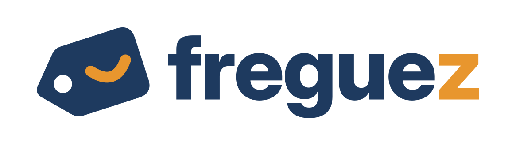
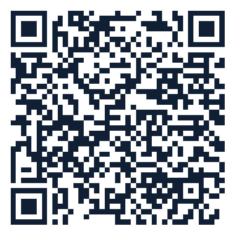

<p align="center">
  
</p>

<h1 align="center">Freguez · Instaladores</h1>

<p align="center">
  Programas do <strong>Freguez</strong> para usar na loja: caixa, totem, cadastro de produtos e app do vendedor.<br>
  Aqui ficam os instaladores oficiais, o que muda em cada versão e como instalar do jeito certo.
</p>

---

## Baixar

| Programa | Para quê | Onde roda | Baixar |
|---|---|---|---|
| **Freguez Caixa** | Vender no balcão, receber crediário, totem de autoatendimento e tela do cliente | Windows 10 ou 11 (64 bits) | [Freguez-Caixa-Setup.exe](https://github.com/EvandoFilhoCosta/Freguez-Instaladores/releases/latest/download/Freguez-Caixa-Setup.exe) |
| **Freguez Cadastro** | Cadastrar produtos e dar entrada no estoque bipando o código de barras | Windows 10 ou 11 (64 bits) | [Freguez-Cadastro-Setup.exe](https://github.com/EvandoFilhoCosta/Freguez-Instaladores/releases/latest/download/Freguez-Cadastro-Setup.exe) |
| **Freguez Vendedor** (Android) | Consultar produto pela câmera, pré-venda, inventário e etiquetas | Android 8 ou mais novo | [Freguez-Vendedor.apk](https://github.com/EvandoFilhoCosta/Freguez-Instaladores/releases/latest/download/Freguez-Vendedor.apk) |
| **Freguez Vendedor** (iPhone) | O mesmo app do Android, pelo Expo Go | iPhone com iOS 15.1 ou mais novo | [QR Code abaixo](#iphone) |

Todas as versões, com o que mudou em cada uma: [Releases](https://github.com/EvandoFilhoCosta/Freguez-Instaladores/releases) e [CHANGELOG.md](CHANGELOG.md).

## iPhone

O app do vendedor para iPhone abre pelo **Expo Go** (gratuito na App Store), sem precisar de loja de apps.

<p align="center">
  
</p>

1. Instale o [Expo Go](https://apps.apple.com/app/expo-go/id982107779) pela App Store.
2. Abra a **Câmera** do iPhone e aponte para o QR Code.
3. Toque em **Abrir no Expo Go**. Na primeira vez, aceite o uso da câmera (é ela que lê o código de barras).
4. Entre com o e-mail e a senha que a loja criou para você.

Atualizações chegam sozinhas: feche e abra o app no Expo Go. Detalhes em [docs/IPHONE.md](docs/IPHONE.md).

## Como instalar

- **Windows (Caixa e Cadastro):** [docs/INSTALACAO-WINDOWS.md](docs/INSTALACAO-WINDOWS.md)
- **Android:** [docs/ANDROID.md](docs/ANDROID.md)
- **iPhone:** [docs/IPHONE.md](docs/IPHONE.md)

Depois de instalar, o programa pede para **parear** com a loja: entre com a conta do dono ou do gerente, ou use o código gerado no painel em **Configurações › Dispositivos**.

## O Windows avisou "o Windows protegeu o computador"?

É o filtro SmartScreen. Ele aparece com programas novos que ainda não têm assinatura digital reconhecida pela Microsoft. Clique em **Mais informações › Executar assim mesmo**. Antes, confira se o arquivo é o original (abaixo). O porquê e o plano para tirar esse aviso estão em [docs/ASSINATURA-DIGITAL.md](docs/ASSINATURA-DIGITAL.md).

## Conferir se o arquivo é original

Cada versão publica o **SHA-256** de cada arquivo nas notas da [Release](https://github.com/EvandoFilhoCosta/Freguez-Instaladores/releases). No Windows, abra o PowerShell na pasta do download e rode:

```powershell
Get-FileHash .\Freguez-Caixa-Setup.exe -Algorithm SHA256
```

O resultado precisa ser igual ao da Release. Se for diferente, não instale.

## Atualização automática

O Caixa e o Cadastro conferem sozinhos se há versão nova ao abrir e se atualizam. Cada atualização é verificada por uma assinatura própria do Freguez antes de instalar: um arquivo alterado no caminho é recusado. O app Android avisa na tela quando há versão nova.

## Suporte

Fale com quem cuida do Freguez na sua loja ou com o suporte pelo painel (**Ajuda**).

---

<sub>Freguez é um sistema proprietário. Estes instaladores são distribuídos gratuitamente para as lojas clientes; veja os [termos de uso](TERMOS.md). Este repositório guarda só os instaladores e a documentação, sem o código-fonte.</sub>
